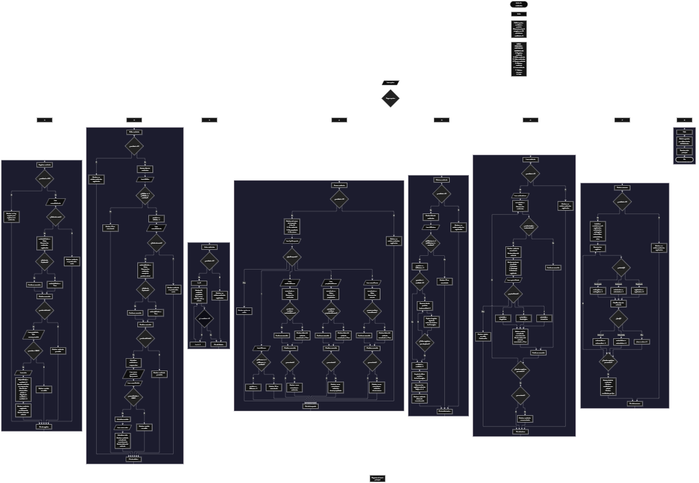

Este proyecto, llamado <b>lector de matriculas</b>, fue desarrollado en <b>visual basic .net</b> como un ejercicio práctico para fortalecer la lógica de programación mediante la creación de un sistema de gestión y lectura de matrículas vehiculares desde la consola. El programa cuenta con un menú principal de ocho opciones que permite <b>registrar, editar, listar, buscar y eliminar matriculas</b>, además de consultar una matrícula para modificar su estado y generar un resumen de los vehículos registrados. Cada vehículo almacena datos como el identificador, la matrícula, el propietario, el tipo, la marca, el modelo y el color, utilizando arreglos paralelos con una capacidad máxima de <b>20 registros durante la ejecución</b>. También permite clasificar los vehículos según su estado, diferenciando entre registrados, autorizados y restringidos. Durante su desarrollo se aplicaron conceptos fundamentales de programación, como variables, arreglos, estructuras condicionales, ciclos repetitivos, estructuras de selección y reorganización de registros. Este proyecto permite poner en práctica los conocimientos adquiridos en Visual Basic .NET y sirve como base para desarrollar sistemas de control vehicular más completos.

<h2 align="center">⚙️ Funcionamiento del menú principal</h2>

### ➕ Registrar matrícula

La opción <b>1) registrar matricula</b> permite almacenar un nuevo vehículo en el sistema. Antes de realizar el registro, el programa comprueba que la variable <b>cantidad</b> sea menor que la capacidad del arreglo <b>ids.Length</b>, que corresponde a <b>20 registros</b>. Si existe espacio disponible, solicita la matrícula y verifica que no esté vacía. Después, utiliza un ciclo <b>For</b> para recorrer las matrículas existentes y comprobar que no haya otra igual, sin distinguir entre mayúsculas y minúsculas mediante el método <b>ToLower()</b>. Si la matrícula no está duplicada, solicita el propietario, el tipo de vehículo, la marca, el modelo y el color. A continuación, comprueba que el modelo sea igual o superior a <b>1900</b>. Si todos los controles se cumplen, genera un identificador mediante la expresión <b>cantidad + 1</b>, almacena los datos en sus respectivos arreglos, establece el estado inicial como <b>"Registrado"</b> e incrementa la variable <b>cantidad</b>. Finalmente, muestra los datos del vehículo registrado. Si la capacidad está completa, la matrícula está vacía, existe un duplicado o el modelo no es válido, presenta el mensaje correspondiente e impide completar el registro.

### ✏️ Editar matrícula

La opción <b>2) editar matricula</b> permite modificar los datos de un vehículo registrado. Primero, el programa comprueba si existen matrículas almacenadas mediante la variable <b>cantidad</b>. Si no hay registros, muestra el mensaje <b>"No existen matriculas registradas."</b>. En caso contrario, utiliza un ciclo <b>For</b> para mostrar todos los vehículos con sus respectivos datos. Después, solicita el ID de la matrícula que se desea editar y comprueba que se encuentre entre <b>1</b> y <b>cantidad</b>. Si el identificador es válido, calcula la posición correspondiente mediante la expresión <b>idEditar - 1</b>. A continuación, solicita la nueva matrícula y verifica que no esté vacía ni duplicada, excluyendo de la comparación el registro que se está modificando. Si la matrícula es válida, actualiza su valor y solicita el nuevo propietario, tipo de vehículo, marca, modelo y color. También comprueba que el nuevo modelo sea igual o superior a <b>1900</b>. Si el modelo es válido, almacena el nuevo modelo y color y muestra los datos actualizados. Si el ID no existe, la matrícula está vacía, se encuentra duplicada o el modelo no es válido, muestra el mensaje correspondiente.

### 📋 Listar matrículas

La opción <b>3) listar matriculas</b> permite visualizar todos los vehículos registrados actualmente en el sistema. Antes de mostrar la información, el programa comprueba si la variable <b>cantidad</b> es igual a cero. Si no existen registros, presenta el mensaje <b>"No existen matriculas registradas."</b>. Si hay matrículas disponibles, utiliza un ciclo <b>For</b> para recorrer los arreglos desde la primera posición hasta la cantidad total de registros. Durante el recorrido, muestra el ID, la matrícula, el propietario, el tipo de vehículo, la marca, el modelo, el color y el estado de cada registro. Esta función facilita consultar toda la información almacenada sin necesidad de buscar cada vehículo individualmente.

### 🔎 Buscar matrícula

La opción <b>4) buscar matricula</b> permite localizar vehículos mediante cuatro modalidades de búsqueda. Primero, el programa comprueba que existan matrículas registradas y presenta un submenú con las opciones disponibles: buscar por ID, por matrícula, por propietario o por marca. El usuario selecciona el método que desea utilizar y el sistema ejecuta el procedimiento correspondiente.

**Búsqueda por ID:** solicita el identificador del vehículo y comprueba que se encuentre entre <b>1</b> y <b>cantidad</b>. Si es válido, obtiene la posición mediante la expresión <b>idBuscar - 1</b> y muestra todos los datos del vehículo. Si no existe, presenta el mensaje <b>"ID no encontrada."</b>.

**Búsqueda por matrícula:** solicita el texto que se desea buscar, inicializa la variable lógica <b>encontrado</b> en <b>False</b> y recorre las matrículas almacenadas. Utiliza los métodos <b>ToLower()</b> y <b>Contains()</b> para localizar coincidencias parciales sin distinguir entre mayúsculas y minúsculas. Si encuentra resultados, muestra los datos de cada vehículo y cambia <b>encontrado</b> a <b>True</b>. Si no encuentra coincidencias, presenta el mensaje <b>"No se encontraron matriculas."</b>.

**Búsqueda por propietario:** solicita el nombre o una parte del nombre del propietario y recorre el arreglo <b>propietarios</b>. Mediante <b>ToLower()</b> y <b>Contains()</b>, compara el texto introducido con los nombres almacenados. Cuando encuentra coincidencias, muestra la información completa de los vehículos correspondientes. Si no encuentra resultados, presenta el mensaje <b>"No se encontraron vehiculos de ese propietario."</b>.

**Búsqueda por marca:** solicita la marca que se desea localizar y recorre el arreglo <b>marcas</b>. Utiliza <b>ToLower()</b> y <b>Contains()</b> para encontrar coincidencias parciales sin diferenciar entre mayúsculas y minúsculas. Si encuentra vehículos de esa marca, muestra sus datos; de lo contrario, presenta el mensaje <b>"No se encontraron vehiculos de esa marca."</b>. Si el usuario introduce una opción de búsqueda diferente de las cuatro disponibles, el programa muestra el mensaje <b>"Opcion no valida."</b>.

### 🗑️ Eliminar matrícula

La opción <b>5) eliminar matricula</b> permite eliminar un vehículo registrado mediante su identificador. Primero, el programa comprueba que existan matrículas almacenadas. Si no hay registros, muestra el mensaje <b>"No existen matriculas registradas."</b>. En caso contrario, presenta una lista con los datos de todos los vehículos y solicita el ID que se desea eliminar. Después, verifica que el identificador esté entre <b>1</b> y <b>cantidad</b> y calcula la posición correspondiente mediante la expresión <b>idEliminar - 1</b>. Si el ID es válido, utiliza un ciclo <b>For</b> para desplazar una posición hacia atrás los datos de los registros posteriores en los ocho arreglos: <b>ids, matriculas, propietarios, tipos, marcas, modelos, colores y estados</b>. Posteriormente, disminuye la variable <b>cantidad</b> en uno y limpia la última posición ocupada de cada arreglo. Finalmente, utiliza otro ciclo <b>For</b> para reorganizar los identificadores de los registros restantes, asignándoles nuevamente valores consecutivos desde <b>1</b>. Al terminar, muestra el mensaje <b>"Matricula eliminada correctamente."</b>. Si el ID seleccionado no corresponde a un vehículo registrado, presenta el mensaje <b>"ID no encontrada."</b>.

### 🚘 Leer matrícula

La opción <b>6) leer matricula</b> permite localizar un vehículo mediante su matrícula y modificar su estado de acceso. Primero, el programa comprueba que existan registros almacenados. Si no hay matrículas, muestra el mensaje <b>"No existen matriculas registradas."</b>. Si existen vehículos, solicita la matrícula que se desea leer e inicializa la variable lógica <b>encontrado</b> en <b>False</b>. A continuación, recorre el arreglo <b>matriculas</b> y compara cada registro con el texto introducido mediante la condición <b>matriculas(i).ToLower() = matriculaLeer.ToLower()</b>. Cuando encuentra una coincidencia exacta, muestra los datos del vehículo y presenta tres opciones para actualizar su estado: <b>1) Autorizar</b>, que establece el estado como <b>"Autorizado"</b>; <b>2) Restringir</b>, que establece el estado como <b>"Restringido"</b>; y <b>3) Mantener registrado</b>, que conserva el estado <b>"Registrado"</b>. La selección se procesa mediante una estructura <b>Select Case</b>. Si el estado seleccionado no corresponde a ninguna opción, muestra el mensaje <b>"Estado no valido."</b> y regresa directamente al menú principal mediante <b>Continue Do</b>. Si la selección es válida, actualiza el estado, muestra el mensaje <b>"Estado actualizado correctamente."</b> y presenta nuevamente todos los datos del vehículo. Si termina la búsqueda sin encontrar la matrícula, presenta el mensaje <b>"Matricula no encontrada."</b>.

### 📊 Mostrar resumen

La opción <b>7) mostrar resumen</b> permite consultar estadísticas generales de los vehículos registrados. Primero, comprueba que la variable <b>cantidad</b> sea diferente de cero. Si no existen registros, muestra el mensaje <b>"No existen matriculas registradas."</b>. Si hay vehículos almacenados, inicializa seis contadores: <b>registrados, autorizados, restringidos, automoviles, motocicletas y otros</b>. Después, utiliza un ciclo <b>For</b> para recorrer los registros y clasificar cada vehículo según su estado y tipo. Mediante estructuras condicionales <b>If</b> y <b>ElseIf</b>, incrementa el contador correspondiente al estado del vehículo. También compara el tipo almacenado en el arreglo <b>tipos</b> con los textos <b>"automovil"</b> y <b>"motocicleta"</b>, utilizando <b>ToLower()</b> para ignorar las diferencias entre mayúsculas y minúsculas. Los vehículos que no coinciden con ninguno de esos dos tipos se contabilizan como otros. Finalmente, muestra el total de matrículas y las cantidades correspondientes a cada estado y categoría de vehículo.

### 🚪 Salir del menú principal

La opción <b>8) salir</b> permite finalizar la ejecución del programa. Cuando el usuario selecciona esta opción, el sistema muestra el mensaje <b>"Gracias por utilizar Lector de Matriculas."</b>. El menú principal se encuentra dentro de una estructura repetitiva <b>Do ... Loop While</b>, que mantiene el programa en funcionamiento mientras la variable <b>opcion</b> sea diferente de <b>8</b>. Cuando se selecciona esta opción, la condición del ciclo se cumple y el programa termina su ejecución.

<h2 align="center">🧠 Temas aplicados en el proyecto</h2>

### 📦 Variables

En este proyecto se utilizan variables para almacenar la opción seleccionada en el menú, controlar la cantidad de matrículas registradas, guardar temporalmente los datos de los vehículos, identificar los registros que se desean editar o eliminar, controlar las búsquedas y contabilizar los resultados del resumen. Cada variable cumple una función específica dentro de las operaciones del sistema.

🔢 **Opcion:** Almacena la opción seleccionada por el usuario en el menú principal.

📊 **Cantidad:** Controla el número actual de matrículas registradas.

🆔 **IdEditar, IdEliminar e IdBuscar:** Almacenan el identificador del vehículo que se desea editar, eliminar o buscar.

📍 **Posicion:** Almacena el índice correspondiente al ID seleccionado, calculado mediante la resta de uno.

📝 **NuevaMatricula y MatriculaBuscar:** Almacenan temporalmente la matrícula que se desea registrar, actualizar o buscar.

🔎 **PropietarioBuscar y MarcaBuscar:** Almacenan los textos introducidos para realizar búsquedas por propietario o marca.

🚘 **MatriculaLeer:** Guarda la matrícula introducida para localizar un vehículo y actualizar su estado.

✅ **Encontrado y MatriculaExiste:** Son variables lógicas que permiten comprobar si se localizó una matrícula o si ya existe un registro duplicado.

🔄 **I:** Funciona como contador en los ciclos `For` utilizados para recorrer, buscar, mostrar, eliminar y reorganizar los registros.

📈 **Registrados, Autorizados y Restringidos:** Contabilizan la cantidad de vehículos según su estado.

🚗 **Automoviles, Motocicletas y Otros:** Contabilizan los vehículos según su categoría.

### 🗃️ Arreglos

En este proyecto se utilizan ocho arreglos paralelos para almacenar la información de los vehículos. Cada arreglo tiene una capacidad de <b>20 posiciones</b> y utiliza el mismo índice para representar los datos correspondientes a una misma matrícula. Por ejemplo, la información de un vehículo ubicado en la posición <b>0</b> se encuentra distribuida entre <b>ids(0), matriculas(0), propietarios(0), tipos(0), marcas(0), modelos(0), colores(0) y estados(0)</b>. Esta organización permite registrar, consultar, modificar, buscar, eliminar y clasificar los vehículos de manera ordenada.

🆔 **Ids(20):** Almacena los identificadores numéricos de los vehículos registrados.

🔠 **Matriculas(20):** Almacena las matrículas de los vehículos.

👤 **Propietarios(20):** Guarda los nombres de los propietarios.

🚘 **Tipos(20):** Almacena los tipos de vehículos registrados.

🏷️ **Marcas(20):** Guarda las marcas de los vehículos.

📅 **Modelos(20):** Almacena los años de los modelos de los vehículos.

🎨 **Colores(20):** Guarda los colores correspondientes a cada vehículo.

📋 **Estados(20):** Almacena los estados de las matrículas, que pueden ser <b>"Registrado"</b>, <b>"Autorizado"</b> o <b>"Restringido"</b>.

### 🔀 Estructuras condicionales

En este proyecto se utilizan las estructuras <b>If, ElseIf y Else</b> para comprobar la disponibilidad de espacio, verificar que la matrícula no esté vacía, detectar registros duplicados, validar los modelos de los vehículos y comprobar que los identificadores seleccionados sean correctos. También permiten determinar si existen registros antes de ejecutar las operaciones, comprobar si una búsqueda encontró resultados y clasificar los vehículos según su estado y tipo. Estas condiciones permiten que el programa responda de manera diferente según los datos introducidos y la situación de los registros almacenados.

### 🔄 Estructuras repetitivas

En este proyecto se utilizan los ciclos <b>Do ... Loop While</b> y <b>For</b>. El ciclo <b>Do ... Loop While</b> mantiene activo el menú principal y permite ejecutar diferentes operaciones hasta que el usuario selecciona la opción de salir. Por otro lado, los ciclos <b>For</b> permiten recorrer los arreglos para comprobar matrículas duplicadas, mostrar los registros, realizar búsquedas por matrícula, propietario o marca, localizar vehículos para cambiar sus estados y calcular las estadísticas del resumen. También se utilizan para desplazar los datos durante la eliminación y reorganizar los identificadores de los vehículos restantes.

### 🎯 Estructura según

El programa utiliza la estructura <b>Select Case</b> para evaluar el valor almacenado en la variable <b>opcion</b> y ejecutar las instrucciones correspondientes a cada alternativa del menú principal. Cada caso representa una operación específica: <b>registrar, editar, listar, buscar, eliminar, leer una matrícula, mostrar el resumen o salir</b>. También se utiliza una estructura <b>Select Case</b> dentro de la opción de lectura de matrículas para seleccionar el nuevo estado del vehículo. En ambos casos, el bloque <b>Case Else</b> permite controlar las selecciones que no corresponden a las opciones disponibles.

### 🔢 Dimensionamiento de arreglos

El programa utiliza la declaración de arreglos con índices desde <b>0 hasta 19</b>, lo que proporciona una capacidad total de <b>20 registros</b> para cada arreglo. La propiedad <b>Length</b> del arreglo <b>ids</b> permite comprobar la capacidad disponible antes de registrar un nuevo vehículo. La cantidad de posiciones ocupadas se controla mediante la variable <b>cantidad</b>, por lo que los ciclos recorren únicamente los registros activos, desde la posición <b>0</b> hasta <b>cantidad - 1</b>. Esta organización permite administrar los vehículos sin recorrer innecesariamente las posiciones que todavía no contienen registros.

### 🔄 Reorganización de registros

Cuando se elimina una matrícula, el programa utiliza un ciclo <b>For</b> que comienza en la posición seleccionada y llega hasta <b>cantidad - 2</b>. En cada repetición, copia los datos de la posición siguiente sobre la posición actual en los ocho arreglos: <b>ids, matriculas, propietarios, tipos, marcas, modelos, colores y estados</b>. Después, disminuye la variable <b>cantidad</b> en uno y limpia los valores de la última posición que estaba ocupada. Finalmente, utiliza otro ciclo <b>For</b> para asignar nuevamente identificadores consecutivos a los registros restantes. De esta manera, los vehículos mantienen su información relacionada y ocupan posiciones continuas después de una eliminación.

### 🔤 Manipulación de cadenas

El proyecto utiliza diferentes métodos para trabajar con los textos almacenados en los arreglos. El método <b>ToLower()</b> convierte temporalmente los textos a minúsculas para realizar comparaciones sin distinguir entre mayúsculas y minúsculas. El método <b>ToUpper()</b> convierte las matrículas a mayúsculas antes de almacenarlas, manteniendo un formato uniforme. Por su parte, el método <b>Contains()</b> permite localizar coincidencias parciales durante las búsquedas por matrícula, propietario y marca. Estos métodos facilitan la comparación y consulta de la información introducida por el usuario.

<h2 align="center">¿Cómo se implementaron las operaciones crud en el proyecto?</h2>

Las operaciones <b>crud</b> se implementaron mediante las opciones del menú principal, permitiendo administrar las matrículas vehiculares registradas. La operación <b>crear</b> corresponde a <b>registrar matrícula</b>, donde se introducen los datos de un nuevo vehículo; <b>leer</b> se realiza mediante las opciones <b>listar matrículas, buscar matrícula y leer matrícula</b>, que permiten consultar los registros almacenados; <b>actualizar</b> corresponde a <b>editar matrícula</b>, donde se modifican los datos de un vehículo, y también a la opción de lectura, que permite cambiar su estado; finalmente, <b>eliminar</b> se realiza mediante la opción <b>eliminar matrícula</b>, donde se retira un registro y se reorganizan los arreglos. Estas operaciones utilizan variables, arreglos, condicionales y ciclos para gestionar la información almacenada temporalmente durante la ejecución del programa.

<h2 align="center">Diagrama de flujo del proyecto</h2>

<h2 align="center">🛡️ Validaciones del programa</h2>

### 📭 No existen matrículas registradas

Esta validación se utiliza en las opciones de <b>editar, listar, buscar, eliminar, leer matrícula y mostrar resumen</b>. El programa comprueba si la variable <b>cantidad</b> es igual a <b>0</b> y, si no existen vehículos almacenados, muestra el mensaje <b>"No existen matriculas registradas."</b>. Esta comprobación evita continuar con las operaciones que necesitan información almacenada cuando el sistema está vacío.

### ⚠️ Capacidad máxima alcanzada

Esta validación se utiliza durante el registro de nuevas matrículas para controlar la capacidad máxima de los arreglos. El programa comprueba si <b>cantidad &gt;= ids.Length</b>, donde <b>ids.Length</b> representa las 20 posiciones disponibles. Si todavía existe espacio, permite continuar con el registro. En caso contrario, muestra el mensaje <b>"No hay espacio para registrar mas matriculas."</b>, impidiendo almacenar más vehículos.

### ❌ Matrícula vacía

Esta validación se aplica durante el registro y la edición de matrículas. El programa comprueba si el texto introducido en la variable <b>nuevaMatricula</b> es igual a una cadena vacía. Si no contiene ningún carácter, muestra el mensaje <b>"La matricula no puede estar vacia."</b> e impide continuar con esa operación. Esta comprobación evita almacenar o actualizar un vehículo utilizando una matrícula vacía.

### 🔁 Matrícula duplicada

Esta validación se utiliza durante el registro y la edición de matrículas. El programa inicializa la variable lógica <b>matriculaExiste</b> en <b>False</b> y recorre los registros existentes para comparar las matrículas mediante <b>ToLower()</b>. Si encuentra una matrícula igual, cambia la variable a <b>True</b> y evita completar el registro o la actualización. Durante la edición, también comprueba que la coincidencia no corresponda al mismo vehículo que se está modificando. Esta validación permite mantener matrículas únicas dentro del sistema.

### 📅 Modelo no válido

Esta validación se utiliza durante el registro y la edición de vehículos. El programa comprueba que el valor introducido en la variable <b>nuevoModelo</b> sea igual o superior a <b>1900</b>. Si el modelo es menor, muestra el mensaje <b>"El modelo no es valido."</b> e impide almacenar ese valor como modelo del vehículo.

### 🆔 ID no encontrado

Esta validación se utiliza durante las operaciones de edición, búsqueda y eliminación. El programa comprueba que el identificador introducido sea mayor o igual a <b>1</b> y menor o igual a <b>cantidad</b>. Si el ID está dentro del rango permitido, calcula la posición correspondiente restando uno al identificador. Si el número seleccionado no corresponde a un vehículo registrado, muestra el mensaje <b>"ID no encontrada."</b> y evita acceder a una posición que no contiene un registro activo.

### 🔎 Matrícula no encontrada

Esta validación se utiliza durante las búsquedas por matrícula y la lectura de vehículos. En las búsquedas parciales, el programa utiliza la variable lógica <b>encontrado</b> para determinar si se localizaron coincidencias mediante <b>Contains()</b>. En la lectura, compara la matrícula introducida con las almacenadas para localizar una coincidencia exacta, sin distinguir entre mayúsculas y minúsculas. Si no encuentra ningún resultado, presenta el mensaje <b>"Matricula no encontrada."</b> o el mensaje correspondiente al tipo de búsqueda utilizado.

### ⚠️ Estado no válido

Esta validación se utiliza durante la lectura de matrículas, cuando el usuario selecciona el nuevo estado del vehículo. El programa utiliza una estructura <b>Select Case</b> para aceptar únicamente las opciones <b>1, 2 y 3</b>, correspondientes a autorizado, restringido y registrado. Si se introduce otro valor, ejecuta el bloque <b>Case Else</b>, muestra el mensaje <b>"Estado no valido."</b> y utiliza <b>Continue Do</b> para regresar al menú principal sin completar la actualización del estado.

### ⚠️ Opción inválida

La estructura <b>Select Case</b> del menú principal incluye el bloque <b>Case Else</b>, que muestra el mensaje <b>"Opcion no valida."</b> cuando el usuario introduce un número que no corresponde a ninguna de las ocho opciones disponibles. También se utiliza una validación equivalente en el submenú de búsqueda para controlar las selecciones que no corresponden a los cuatro métodos disponibles.

<h2 align="center">🎯 Objetivo del proyecto</h2>

El objetivo principal de este proyecto es fortalecer la <b>lógica de programación</b> mediante el desarrollo de un sistema de gestión y lectura de matrículas vehiculares en <b>visual basic .net</b>. A través de su construcción se busca aplicar los conocimientos adquiridos sobre variables, arreglos, estructuras condicionales, ciclos repetitivos y estructuras de selección, integrándolos para resolver un problema de manera organizada. Además, el proyecto permite comprender cómo registrar, consultar, modificar, eliminar y clasificar información de vehículos, así como controlar sus estados de acceso mediante una aplicación de consola.

